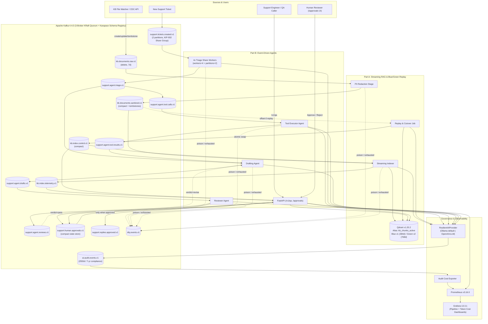

# kafka-realtime-ai

[](https://github.com/Manzoor25/kafka-realtime-ai/actions/workflows/ci.yml)
[](LICENSE)

A runnable, production-patterned **real-time streaming RAG and event-driven multi-agent support platform** built on **Apache Kafka 4.4.0 (KRaft + KIP-932 Share Groups)**, **Karapace JSON Schema Registry**, **Qdrant**, **FastAPI**, **Ollama** (zero API keys required), **Prometheus**, and **Grafana**.

---

## The Problem

Enterprise support teams update runbooks, incident advisories, and policies continuously throughout the day while new customer tickets arrive every minute. Nightly batch RAG pipelines fail this reality in four ways:
1. **Stale answers:** An assistant backed by last night's cron index confidently gives yesterday's wrong procedure during a live incident.
2. **PII & secret leakage:** Raw emails, phone numbers, SSNs, payment cards, and API keys get baked directly into dense embeddings and vector payloads.
3. **Downtime on embedding upgrades:** Moving from a 384-dim model to a stronger 768-dim model requires custom database dump scripts and maintenance windows.
4. **Brittle synchronous agents:** Point-to-point HTTP agent chains drop tickets during 2-minute LLM outages, suffer partition head-of-line blocking on slow LLM calls, and risk sending unreviewed replies without a human-in-the-loop gate or compliance audit trail.

`kafka-realtime-ai` solves both halves on a single immutable event log:
- **Part A — Streaming Retrieval:** File watcher / CDC webhook $\rightarrow$ Kafka raw topic $\rightarrow$ dedicated **PII Redaction stream stage** $\rightarrow$ log-compacted sanitized corpus $\rightarrow$ deterministic UUIDv5 idempotent Qdrant indexer + tombstone deletes $\rightarrow$ **zero-downtime Kafka replay & atomic alias switchover** $\rightarrow$ `/v1/qa` with citations and measured ingest-to-retrievable freshness.
- **Part B — Event-Driven Agents:** Incoming tickets consumed via a **KIP-932 Share Group** (`4 workers > 2 partitions`, per-record `ACCEPT`/`RELEASE`/`REJECT`) $\rightarrow$ **Triage**, **Tool Executor**, **Drafter**, and **Reviewer** agents communicating exclusively through JSON-Schema-validated Kafka topics $\rightarrow$ compacted **Human Approval Web Console** (`/approvals`) $\rightarrow$ **7-year compliance audit topic** (`ai.audit.events.v1`) powering a live Grafana token & cost dashboard.

---

## Architecture



---

## Pinned Stack

| Component | Exact Version | Purpose |
| :--- | :--- | :--- |
| **Apache Kafka** | `apache/kafka:4.4.0` | 3-broker KRaft cluster (`share.version=1` KIP-932 Share Groups enabled) |
| **Schema Registry** | `ghcr.io/aiven-open/karapace:6.2.4` | Apache-2.0 JSON Schema registry (`BACKWARD` compatibility, 5-byte wire header) |
| **Vector Store** | `qdrant/qdrant:v1.20.2` | Versioned collections, UUIDv5 idempotent points, `<1 ms` atomic alias cutover |
| **Local AI Runtime** | `ollama/ollama:0.40.16` | Default zero-API-key inference (`all-minilm:22m`, `nomic-embed-text:v1.5`, `qwen2.5:0.5b`) |
| **API & Workers** | Python `3.12.10`, FastAPI `0.162.2`, `confluent-kafka==2.16.1` | Streaming stages, KIP-932 `ShareConsumer` adapter, QA API & Jinja2 approval UI |
| **Observability** | `prom/prometheus:v3.16.0`, `grafana/grafana:13.3.1` | Freshness, share-group redelivery, DLQ, and 7-year audit token/cost dashboards |

---

## One-Command Quickstart

```bash
# 1. Build and start the 3-broker Kafka 4.4.0 KRaft cluster, Karapace, Qdrant, Ollama, Prometheus, Grafana & workers
make up

# 2. Run the end-to-end walkthrough (live KB ingestion + PII scrubbing + QA freshness + ticket triage + human approval)
make demo

# 3. Run unit tests, integration tests, and the before/after model-switch retrieval benchmark
make test

# 4. Tear down all containers and volumes cleanly
make down
```

### Live Endpoints (when `make up` is running)
- **FastAPI Docs & QA API:** `http://localhost:8000/docs` (`POST /v1/qa`, `GET /v1/freshness`, `POST /v1/kb/reembed`)
- **Human Approval Web UI:** `http://localhost:8000/approvals`
- **Grafana Dashboards:** `http://localhost:3000` (anonymous viewer enabled; `admin` / `admin` — includes *Pipeline & Freshness Overview* and *AI Compliance Audit & Token Cost*)
- **Prometheus:** `http://localhost:9090`
- **Karapace Schema Registry:** `http://localhost:8081/subjects`

### Switching to a Hosted LLM / Embedding Provider (Config Only)
No code changes required—override environment variables when starting Compose:
```bash
AI_PROVIDER=openai \
OPENAI_BASE_URL=https://api.openai.com/v1 \
OPENAI_API_KEY=sk-... \
EMBEDDING_MODEL=text-embedding-3-small \
EMBEDDING_DIMENSIONS=1536 \
CHAT_MODEL=gpt-4o-mini \
make up
```

### Running Offline / Without Docker (Hermetic In-Memory Harness)
Every demo, test, and benchmark also supports `--in-memory` / `--provider local` (using `memory://` Kafka + KIP-932 share-group simulator and embedded Qdrant `:memory:`):
```bash
python -m pip install -e ".[dev]"
python scripts/run_demo.py --in-memory
python scripts/evaluate_retrieval.py --provider local
python -m pytest tests/unit tests/integration -v -m "not docker_e2e"
```

---

## Failure Demos (Runnable Scripts + Expected Output)

### 1. Two-Minute LLM Provider Outage (`make demo-outage`)
Takes the `ollama` provider offline for 120 seconds (`docker stop krai-ollama`, or `--in-memory --outage-seconds 120`), submits 6 customer tickets while the LLM is down, verifies workers release share locks and gate polling via the health-probe circuit (`dlq_count=0`), then restores the provider and confirms all 6 tickets drain with zero loss.
```bash
make demo-outage
# Fast offline check: python scripts/failure_demos/demo_1_llm_outage.py --in-memory --outage-seconds 5
```
**Expected output:**
```text
[STEP 1] Stopping `ollama` container for 120s to simulate full LLM provider outage...
[STEP 2] Submitting 6 customer support tickets while LLM is DOWN...
[STEP 3] Holding LLM provider offline for 120s (tickets remain queued in Kafka, 0 lost)...
         t+120s/120s: approvals_ready=0/6 (queued safely in Kafka)
[STEP 4] Restoring `ollama` container and waiting for queued tickets to drain...
[ASSERT PASS] All 6/6 tickets queued safely during outage and processed with ZERO loss!
```

### 2. Kill an Agent Worker Mid-LLM-Call (`make demo-kill-worker`)
Submits a ticket and sends `SIGKILL` (`docker kill -s KILL`) to the active `TriageAgent` container mid-inference before it acknowledges its KIP-932 Share Group record. After share-lock expiry, a surviving triage worker receives the redelivered ticket (`delivery_count=2`), completes triage/draft/review, and human approval emits **exactly one** customer reply.
```bash
make demo-kill-worker
# Offline harness: python scripts/failure_demos/demo_2_kill_worker.py --in-memory
```
**Expected output:**
```text
[STEP 1] Submitting ticket TKT-KILL-...
[STEP 2] Sent SIGKILL to krai-agent-triage-1 mid-LLM-call!
[STEP 3] Waiting for KIP-932 share record lock expiry (20s) and redelivery to surviving worker...
[STEP 4] Approving redelivered ticket once as human operator...
[ASSERT PASS] Ticket TKT-KILL-... survived mid-call worker kill, was redelivered once, and produced 1 customer-facing reply!
```

### 3. Duplicate Document Event Idempotency (`make demo-duplicate-doc`)
Publishes the exact same `KbDocumentRawEvent` twice to `kb.documents.raw.v1` and verifies deterministic `UUIDv5(doc_id:chunk_hash:embedding_version)` point IDs leave Qdrant's vector count unchanged (`delta = 0`), then sends a Kafka tombstone and confirms `0` vectors remain.
```bash
make demo-duplicate-doc
# Offline harness: python scripts/failure_demos/demo_3_duplicate_doc.py --in-memory
```
**Expected output:**
```text
Indexed chunks for KB-DUP-... after delivery #1: 3 -> after delivery #2: 3 (delta = 0 duplicates!) -> after tombstone: 0
[ASSERT PASS] Duplicate delivery created 0 duplicate vectors in Qdrant.
```

### 4. Zero-Downtime Embedding Model Switch Under Live QA Traffic (`make demo-live-reembed`)
Fires continuous `/v1/qa` requests on a background thread while replaying compacted `kb.documents.sanitized.v1` from offset `0` into a new 768-dimension index (`nomic-embed-text:v1.5` / `local-semantic-v2`) and swapping Qdrant's `kb_chunks_active` alias atomically.
```bash
make demo-live-reembed
# Offline harness: python scripts/failure_demos/demo_4_live_reembed.py --in-memory
```
**Expected output:**
```text
[REPLAY COMPLETE] Switched active alias -> kb_chunks_nomic_embed_text_v1_5_v2_live (replay=...ms, atomic_cutover=<5ms)
[ASSERT PASS] Answered continuous QA queries across v1 -> v2-live model switch with 0 errors (100.0% uptime).
```

---

## Measured Retrieval Evaluation & Freshness

Running `make eval` (`scripts/evaluate_retrieval.py`) and the live 3-broker Docker Compose E2E suite evaluates our 12-query support benchmark (`data/eval/retrieval_eval.json`: 5 lexical queries + 7 semantic paraphrase queries) and pipeline latencies across both the real 3-broker Kafka 4.4.0 + Ollama + Qdrant stack and the deterministic CPU harness:

| Environment | Measured Pipeline Freshness | Before Switch (`v1`, 384-dim) | Replay / Atomic Cutover | After Switch (`v2`, 768-dim) | Live QA Uptime Across Switch |
| :--- | :--- | :--- | :--- | :--- | :--- |
| **3-Broker Kafka 4.4.0 + Ollama + Qdrant (Docker E2E)** | Incremental single-doc: **`74.0 ms`** (`p50 = 2.52 s`, `p95 = 4.90 s` across initial 9-doc cold-start batch) | `all-minilm:22m`: Recall@1 **100.00%**, MRR@3 **1.0000** | Replay `13.40 s` (31 chunks on CPU Ollama), atomic cutover **`12.71 ms`** | `nomic-embed-text:v1.5`: Recall@1 **100.00%**, MRR@3 **1.0000** | **100.0% (`0` errors across 36 concurrent `/v1/qa` calls, mean `313.7 ms`)** |
| **Deterministic Local Harness (`LocalCPUProvider`)** | In-process synchronous `< 5 ms` | `local-hash-v1`: Recall@1 **75.00%**, Recall@3 **100.00%**, MRR@3 **0.8750** | Replay `22.7 ms` (8 docs / 31 chunks), atomic cutover **`0.17 ms`** | `local-semantic-v2`: Recall@1 **100.00%**, Recall@3 **100.00%**, MRR@3 **1.0000** (**+25.00%** Recall@1) | **100.0% (`0` errors)** |

---

## Documentation & Architecture Decisions

- [`docs/design.md`](docs/design.md) — System requirements, 14-topic topology, why a log suits AI pipelines, KIP-932 Share Groups vs. classic consumer groups, guarantees, governance, trade-offs, and production evolution.
- [`docs/adr/`](docs/adr/) — Architecture Decision Records:
  - [ADR-0001: Apache Kafka 4.4.0 KRaft and KIP-932 Share Groups](docs/adr/0001-apache-kafka-4-kraft-and-kip-932-share-groups.md)
  - [ADR-0002: Qdrant Vector Store with UUIDv5 Idempotency and Alias Cutover](docs/adr/0002-qdrant-vector-store-and-zero-downtime-alias-cutover.md)
  - [ADR-0003: Draft-07 JSON Schema and Karapace Schema Registry](docs/adr/0003-json-schema-and-karapace-schema-registry.md)
  - [ADR-0004: Streaming PII Redaction Before Compaction and Embedding](docs/adr/0004-streaming-pii-redaction-before-embedding.md)
  - [ADR-0005: Local-First Pluggable AI Providers and Consumer Backpressure](docs/adr/0005-local-first-pluggable-ai-providers-and-backpressure.md)
  - [ADR-0006: Compacted Human Approval State and 7-Year Audit Governance](docs/adr/0006-compacted-state-topics-and-7-year-audit-governance.md)
- [`docs/interview-questions.md`](docs/interview-questions.md) — 10 customer & principal-level interview questions and answers.
- [`docs/linkedin-article.md`](docs/linkedin-article.md) & [`docs/linkedin-post.md`](docs/linkedin-post.md) — First-person engineering write-up and short post grounded in measured build numbers.

## License

Licensed under the [Apache License, Version 2.0](LICENSE).
